# zmk-config-roBa

## Fluid Voice

デフォルトレイヤーで `B` と左ロータリー直下の `F13` を同時押しすると、
ホストへ `F20` を送ります。Fluid Voice の Primary Dictation Shortcut を `F20`、
Activation Mode を `Automatic (Both)` に設定してください。

- 短押し: 音声入力をトグル
- 長押し: 押している間だけ音声入力（push-to-talk）

`F13` 単独の既存割り当ては変更していないため、Aqua Voice は従来どおり利用できます。
